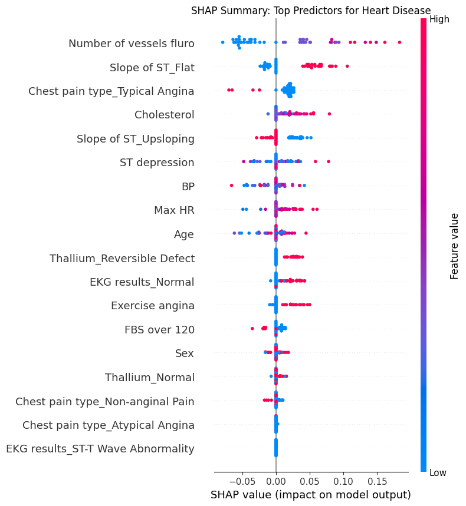
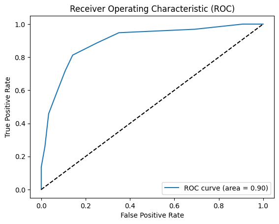
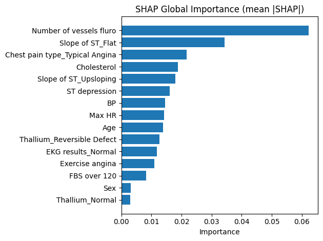
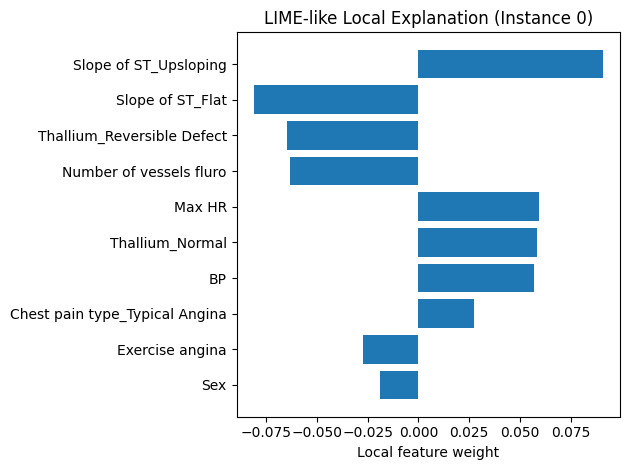
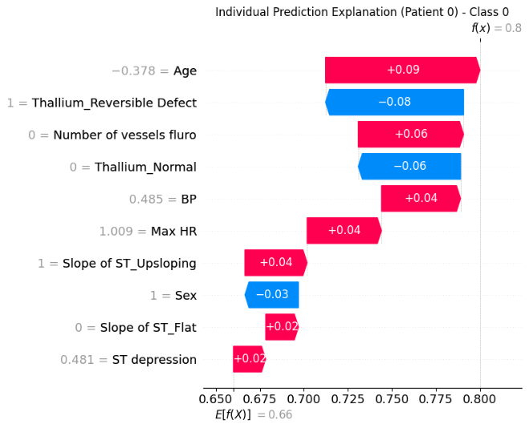
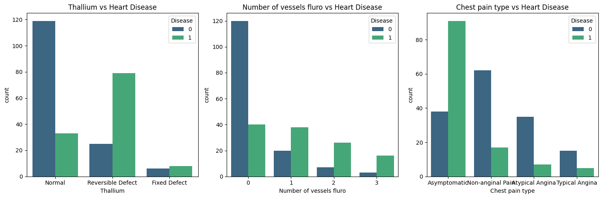
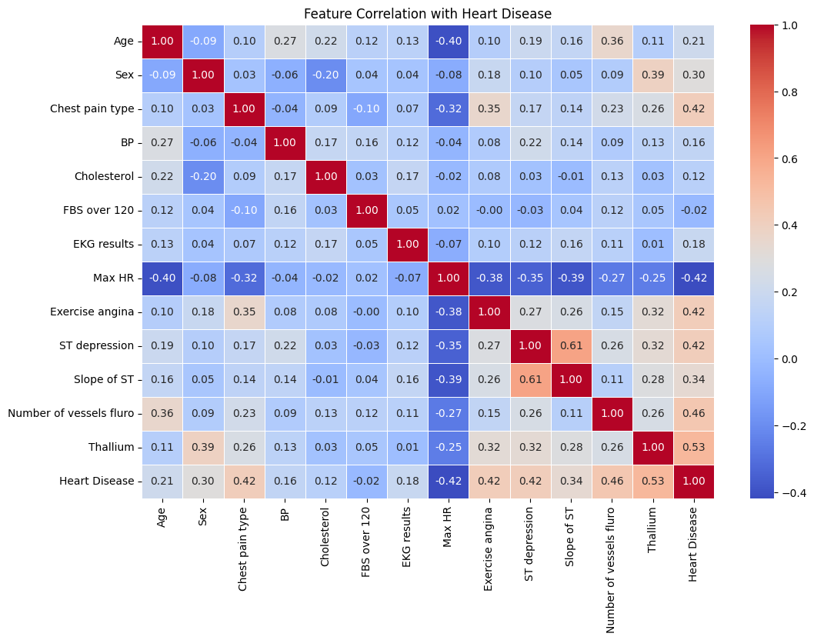

# Few-Shot Learning and Explainable AI for Heart Disease Classification

[](https://colab.research.google.com/github/Arefashaily/Few-shot-learning-and-XAI-on-heart-diseases-Classification/blob/main/notebooks/heart_disease_few_shot_xai.ipynb)


How far can a heart disease classifier get with only a handful of labelled patients, and can a clinician see why it made each decision?

This project trains a K-Nearest Neighbors classifier on as few as **10 labelled patients**, tests it on **216 unseen patients**, and explains its predictions globally with SHAP and locally with a LIME-style surrogate model.

Built for CSE427 at BRAC University. Read the [IEEE-format paper](report/few-shot-xai-heart-disease-ieee-paper.pdf) or the [full report](report/few-shot-xai-heart-disease-final-report.pdf).

<p align="center">
  
</p>

## Results

| Setup | Labelled patients used for training | Evaluated on | Result |
|---|---|---|---|
| **Few-shot KNN** (k=5, distance weights) | 10 (5 per class) | 216 held-out patients | **67.59% accuracy**, disease recall 0.78, precision 0.60, F1 0.68 |
| **Tuned KNN** (Manhattan, k=11, uniform weights) | 54 (20% of the data) | 216 held-out patients | **ROC-AUC 0.90** |
| **Tuned KNN, 5-fold cross-validation** | Full dataset (270) | Held-out folds | **82.22% ± 2.51% accuracy** |

These rows answer different questions, because each one uses a different amount of training data. The first is the true few-shot setting. The last shows what the same features can achieve when more labels are available.

The few-shot model favours recall on the disease class, finding 78% of patients with heart disease from just 10 examples. It pays for that with more false alarms.

<p align="center">
  
</p>

## What the model relies on

SHAP was computed on 50 test patients with a 10-sample background.

- **Number of vessels on fluoroscopy** is the strongest predictor by a wide margin. More affected vessels push the prediction towards disease.
- **A flat ST slope** and the **chest pain type** follow, which fits their known link to coronary artery disease.
- The local surrogate shows that the main drivers for one patient can differ from the global ranking. For patient 0, the ST slope outweighs the vessel count.

| Global: SHAP mean importance | Local: one patient, LIME-style weights |
|---|---|
|  |  |

The waterfall plot below breaks one prediction into per-feature contributions. Here the probability of *no disease* rises from a 0.66 baseline to 0.80. This figure comes from the project report.

<p align="center">
  
</p>

## Dataset

[Heart Disease Prediction](https://www.kaggle.com/datasets/rishidamarla/heart-disease-prediction) from Kaggle: 270 patients, 13 clinical features and a binary label (150 absence, 120 presence), with no missing values or duplicates.

Stress-test and imaging features separate the classes most clearly, as these distributions and correlations show.



<details>
<summary>Feature correlation heatmap</summary>



</details>

## Method

1. **Preprocess.** Cap cholesterol at the 99th percentile, one-hot encode the categorical features (18 inputs in total) and standardise the continuous ones.
2. **Simulate scarce data.** Make a stratified 20/80 split, then draw 5 patients per class as the few-shot support set.
3. **Classify.** Fit KNN on the support set, then tune neighbours, weighting and distance metric with 5-fold grid search on the 54-patient training split.
4. **Explain.** Use SHAP `KernelExplainer` for global importance and single-patient waterfalls, and a custom Ridge-based local surrogate in the style of LIME.
5. **Compare.** Put SHAP's global ranking next to the local explanation for the same features.

KNN was chosen because it has no weights to learn, so it holds up in very small samples. Its comparison of a new patient against similar past patients is also easy to explain.

## Run it

The quickest way is the **Open in Colab** badge above. To run locally:

```bash
git clone https://github.com/Arefashaily/Few-shot-learning-and-XAI-on-heart-diseases-Classification.git
cd Few-shot-learning-and-XAI-on-heart-diseases-Classification
pip install -r requirements.txt jupyter
jupyter notebook notebooks/heart_disease_few_shot_xai.ipynb
```

The first code cell downloads the dataset from a shared Google Drive link. If that link stops working, download the CSV from Kaggle and point `pd.read_csv` at it.

## Limitations

- **Small, single-source data.** With 270 patients from one dataset, these results don't show how the model would perform in a clinic. This is a research project and isn't a diagnostic tool.
- **Few-shot in the practical sense.** This uses KNN on a small support set and doesn't use a meta-learning method such as Prototypical Networks. A class-centroid model is fitted in the notebook but not evaluated.
- **One random split.** The 67.59% and 0.90 figures come from a single seed, so they will vary with a different support set.
- **Mild preprocessing leakage.** The cholesterol cap and scaler are fitted on all the data before splitting.
- **Report figures differ from the notebook.** The PDFs quote some numbers (for example about 78% accuracy) that the saved notebook does not reproduce. The figures in this README come from the notebook's saved outputs.
- **LIME-style explanation.** The local explanation is a custom surrogate and doesn't use the `lime` library.

## Repository layout

```text
├── notebooks/heart_disease_few_shot_xai.ipynb   EDA, models, SHAP and LIME-style analysis
├── report/                                      IEEE-format paper and full report (PDF)
├── assets/                                      Figures used in this README
└── requirements.txt
```

## Authors

Nazifa Anjum Prova, Maisha Iffat Chowdhury and Sultana Khairum Arefa, Department of Computer Science and Engineering, BRAC University.
